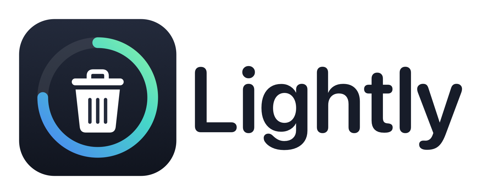

<p align="center">
  <picture>
    <source media="(prefers-color-scheme: dark)" srcset="design/logo/lightly-logo-on-dark.png">
    
  </picture>
</p>

A native macOS menu bar app that cleans junk by itself. There is nothing to press.

It lives in the menu bar as a small white logo and, by default, runs every hour, day and night, or at the next wake if the Mac was asleep.

## Features

### Cleans by itself

- Runs every hour, or every 3, 6 or 12 hours, or once a day
- Catches up at the next wake if the Mac was asleep
- Runs quietly in the background, with no Dock icon and no main window
- Opens at login
- Can be paused at any time, with a manual "Clean now" for when you want space right away

### Stays safe

- Never touches external drives, personal folders or system folders
- Never asks for an admin password
- Skips apps that are open, and moves app leftovers to the Trash first
- Lets you switch off any category, and keep any file or folder for good
- Offers a dry run that lists what a clean would remove, and deletes nothing

### Shows what's happening

- Disk, memory, CPU and battery as live rings
- The last clean, broken down by category
- A summary of this month's cleaning
- A paged history of every clean

### Dusty, your on-device assistant

- Describes each clean in plain words, and explains any problems
- Chats about your Mac, remembers follow-up questions and writes lists
- Scans for the biggest items and explains what they probably are
- Runs on Apple Intelligence, so nothing leaves your Mac

## Requirements

- macOS 27
- Full Disk Access, only for cleaning the Trash
- A Mac with Apple Intelligence, only for Dusty. Everything else works without it.

## What you see

- **Menu bar window:** click the logo for disk, memory, CPU and battery as rings, and the last clean with a summary of this month's cleaning. A "Clean now" button appears only when "Clean automatically" is off. The bottom row has an "Open full view" link, the gear icon and a red quit button.
- **Full view:** larger rings, the last clean by category, a paged cleaning history, Dusty, a chat assistant powered by Apple Intelligence, and "Clean now" for when you want space right away. It also cleans the weekly developer caches.
- **Settings:** the gear icon opens them.

## What it cleans

- App caches, in `~/Library/Caches`, skipping any app that is open
- Logs older than 7 days, keeping crash reports
- Trash items older than 30 days (needs Full Disk Access)
- Leftovers from apps that have been gone for 30 days, moved to the Trash first
- Developer caches once a week: npm, yarn, pnpm, pip, Homebrew, Xcode DerivedData
- Docker build cache and dangling images, only when Docker's data is on the internal disk

## What it never touches

- External drives
- Documents, Desktop, Downloads, Photos, Mail or browser profiles
- System folders. It never asks for an admin password.
- Anything you add to the "Always kept" list

Every deletion goes through one gateway, `DeletionGateway`, which refuses anything outside these rules.

**Cleaning is permanent and needs no confirmation.** Read the dry-run list before you run a live build.

## Settings

- Open at login
- Use Apple Intelligence
- Clean automatically, and how often: every hour (the default), 3, 6 or 12 hours, or once a day
- What to clean: a switch for each category
- Always kept: files and folders that are never cleaned
- Full Disk Access status

## Dusty and Apple Intelligence

On Macs that support it, the on-device model describes each clean in plain words. As Dusty, it also chats about your Mac in the full view:

- Ask "What's using my disk?", then follow up with "What's the second one?". Dusty remembers the last 4 exchanges.
- Ask it to "list down the biggest items" for a numbered list.
- Press Scan to find the biggest items and hear what they probably are.

The chat stays in memory until you quit, and is never saved.

Dusty only rewords measured facts. It has no tools, it cannot decide what gets deleted, and its answers are checked against those facts. An answer that fails the check is replaced by the facts. It knows the folder totals and the 12 biggest items, so a list can be short or incomplete. Nothing leaves your Mac, and you can switch it off in Settings.

## Build

Requires macOS 27.

```bash
swift test
scripts/bundle.sh
```

`scripts/bundle.sh` builds `dist/Lightly.app` as a **dry run**, which deletes nothing. To see what a clean would remove:

```bash
"dist/Lightly.app/Contents/MacOS/MacCleaner" --dry-run-report
```

The list is written to `~/Library/Application Support/com.maccleaner.app/dry-run.txt`.

## Install

Only `scripts/bundle.sh --live` makes a build that really deletes.

1. Run `scripts/bundle.sh --live`.
2. Copy `dist/Lightly.app` to `/Applications` and launch it from there, because the login item stays tied to where the app first ran.
3. Turn on Full Disk Access in System Settings so the Trash can be cleaned.

The first automatic clean waits one full interval after the first launch, an hour by default.

## Design

The design and plan are in `docs/superpowers/`. Logo files are in `design/logo/`. Dusty's loading animation is based on the Loading State component from [beautifului.dev](https://www.beautifului.dev/) (MIT).

## Support

If Lightly saves you some space, you can buy me a coffee.

<a href="https://www.buymeacoffee.com/jsonrls" target="_blank"></a>

## License

MIT. See [LICENSE](LICENSE).
